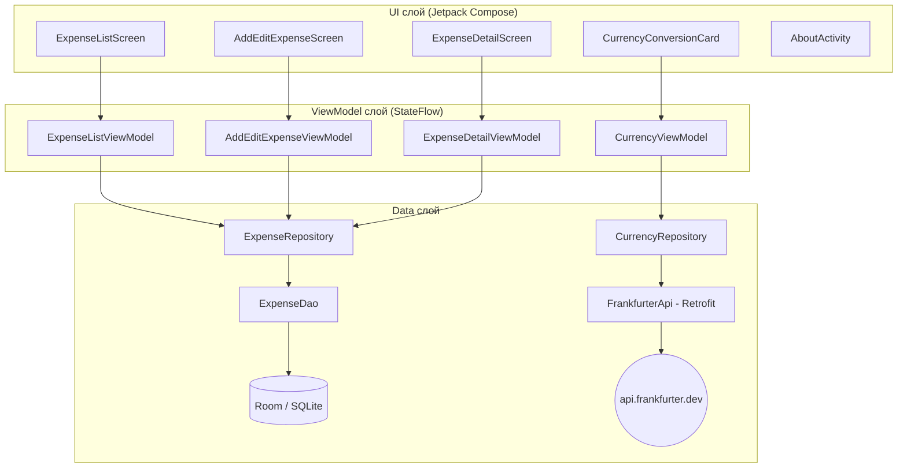
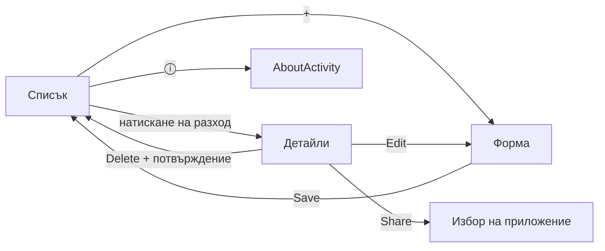
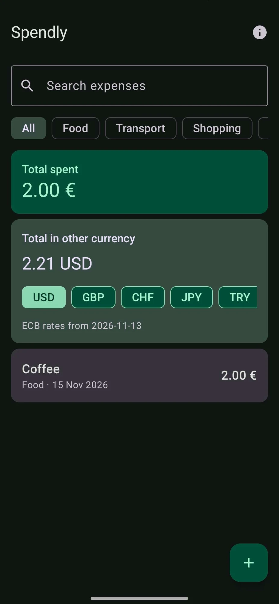
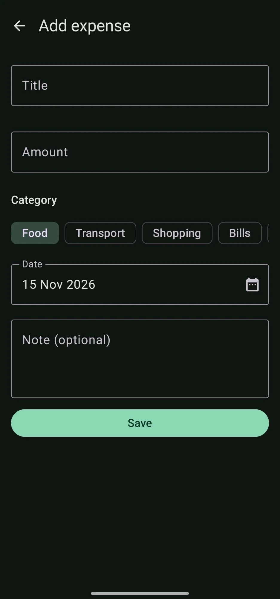
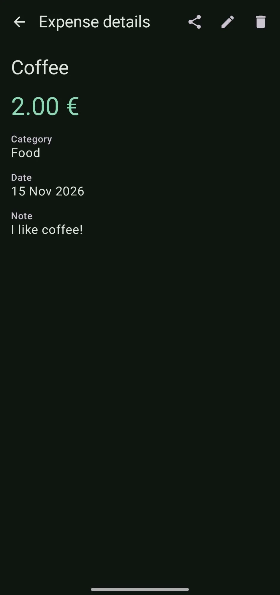
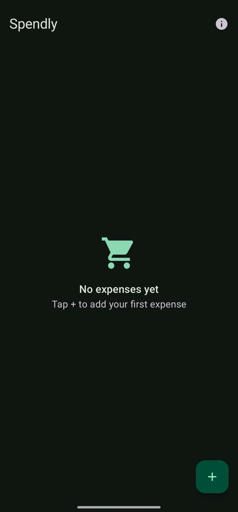
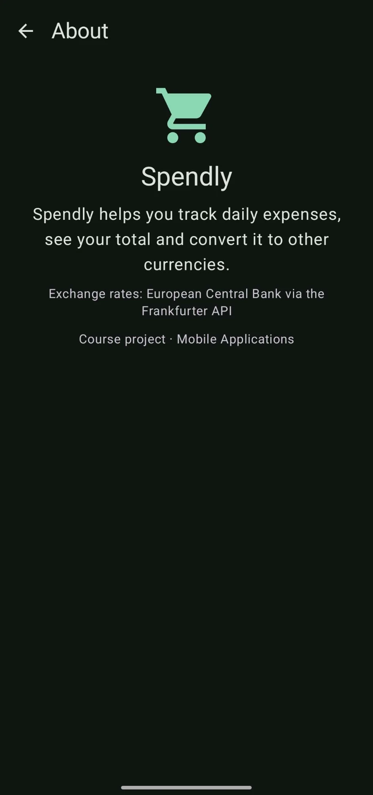

# Spendly – проследяване на разходи

**Spendly** е Android приложение за записване на ежедневни разходи, преглед на общата сума и
превръщането ѝ в други валути по актуалния курс на Европейската централна банка.

|                |                                               |
| -------------- | --------------------------------------------- |
| **Студент**    | Светомир Коев, ФН 2401321055                  |
| **Дисциплина** | Мобилни приложения (2026/2027)                |
| **Платформа**  | Android 7.0+ (Min SDK 24, Target SDK 37)      |
| **Език / UI**  | Kotlin, Jetpack Compose, Material 3           |
| **APK**        | [`/apk/app-release.apk`](apk/app-release.apk) |

---

## Идея

Повечето хора не знаят колко харчат за храна, транспорт или забавления, докато не погледнат
банковото си извлечение. Spendly дава бърз начин да се запише всеки разход в момента, в който
е направен, да се види общата сума и да се филтрира по категория. Понеже много разходи се
правят в чужбина или онлайн, приложението показва и колко е общата сума в USD, GBP, CHF и
други валути.

---

## Как работи

Spendly съхранява всички разходи локално в SQLite база чрез **Room**, затова данните остават
след рестарт и приложението работи без интернет. Началният екран показва списък с разходите,
общата сума, търсене по заглавие и филтър по категория. Бутонът **„+“** отваря форма за
заглавие, сума, категория, дата и бележка; **ViewModel** валидира данните преди запис.
От детайлния екран разходът може да се **редактира**, **сподели** (Share Intent) или
**изтрие** с потвърждение и възможност за **Undo**. Картата „Total in other currency“
изтегля курсовете на ЕЦБ от **Frankfurter REST API** чрез Retrofit и превръща общата сума в
избрана валута; без интернет показва грешка и бутон **Retry**. Екранът **About** е отделна
Activity, отворена с explicit Intent. Всички екрани следват Material 3 и поддържат светла и
тъмна тема.

---

## Архитектура

Приложението следва **MVVM + Repository** с **Hilt** за Dependency Injection и
еднопосочен поток на данните (UI → събитие → ViewModel → нов `StateFlow` → UI).



| Слой           | Отговорност                                                   | Основни класове                                                                                  |
| -------------- | ------------------------------------------------------------- | ------------------------------------------------------------------------------------------------ |
| **UI**         | Рисува състоянието и праща събития нагоре                     | `*Screen.kt`, `SpendlyNavHost`, `AboutActivity`                                                  |
| **ViewModel**  | Държи UI състоянието, валидира, преживява завъртане на екрана | `ExpenseListViewModel`, `AddEditExpenseViewModel`, `ExpenseDetailViewModel`, `CurrencyViewModel` |
| **Repository** | Единствен източник на данни за ViewModel-ите                  | `ExpenseRepository`, `CurrencyRepository` (+ `Impl`)                                             |
| **Data**       | Room база и REST клиент                                       | `Expense`, `ExpenseDao`, `AppDatabase`, `FrankfurterApi`                                         |
| **DI**         | Hilt модули, които създават и свързват обектите               | `DatabaseModule`, `NetworkModule`, `RepositoryModule`                                            |

**Структура на пакетите**

```
com.svetomir.spendly
├── data
│   ├── local        Expense, Category, ExpenseDao, AppDatabase
│   ├── remote       FrankfurterApi, RatesResponse
│   └── repository   ExpenseRepository(+Impl), CurrencyRepository(+Impl)
├── di               DatabaseModule, NetworkModule, RepositoryModule
├── ui
│   ├── list         списък, търсене, филтри, Undo
│   ├── addedit      форма за добавяне и редакция
│   ├── detail       детайли, редакция, изтриване, Share
│   ├── currency     конвертиране на валута (REST)
│   ├── navigation   маршрути и NavHost
│   ├── theme        Material 3 светла/тъмна тема
│   └── util         форматиране на суми и дати
├── MainActivity     хост на навигацията
├── AboutActivity    втора Activity (explicit Intent)
└── SpendlyApp       @HiltAndroidApp
```

**Технологии**

| Технология                        | Версия                 | За какво се използва                   |
| --------------------------------- | ---------------------- | -------------------------------------- |
| Kotlin                            | 2.2.10                 | Език                                   |
| Android Gradle Plugin             | 9.5.1                  | Билд                                   |
| Jetpack Compose BOM               | 2026.02.01             | UI                                     |
| Material 3                        | от BOM                 | Тема, компоненти, светъл/тъмен режим   |
| Navigation Compose                | 2.9.6                  | Type-safe навигация между екраните     |
| Room                              | 2.8.4                  | Локална SQLite база                    |
| Hilt                              | 2.59                   | Dependency Injection                   |
| Retrofit                          | 3.0.0                  | REST клиент                            |
| OkHttp                            | 5.1.0                  | HTTP + logging                         |
| kotlinx.serialization             | 1.9.0                  | JSON                                   |
| Coroutines / Flow                 | 1.10.2                 | Асинхронна работа и реактивни данни    |
| JUnit 4, Turbine, coroutines-test | 4.13.2 / 1.2.1         | Unit тестове                           |
| Compose UI Test + Espresso        | от BOM / 3.5.1         | UI тестове                             |
| ktlint / detekt                   | 14.2.0 / 2.0.0-alpha.6 | Стил и качество на кода                |
| LeakCanary                        | 2.14                   | Откриване на memory leaks (само debug) |

---

## Потребителски поток

1. Приложението се отваря на **списъка с разходи**. При първо стартиране се вижда празно
   състояние с подсказка „Tap + to add your first expense“.
2. Потребителят натиска **„+“** и попълва заглавие, сума, категория, дата и бележка.
   При празно заглавие или сума ≤ 0 се показва грешка под полето.
3. След **Save** разходът се появява в списъка, а **Total spent** и картата с другата валута
   се обновяват автоматично.
4. Със **търсачката** и **чиповете за категория** списъкът се филтрира.
5. С натискане на разход се отваря **детайлният екран** с бутони **Share**, **Edit** и **Delete**.
6. **Delete** иска потвърждение; след изтриване в списъка се появява snackbar с **Undo**.
7. В картата **Total in other currency** се избира валута (USD, GBP, CHF, JPY, TRY, RON).
8. Иконата **ⓘ** отваря екрана **About** (отделна Activity).



---

## Стъпки за стартиране

**Готов APK**

1. Изтеглете [`apk/app-release.apk`](apk/app-release.apk) на Android телефон (Android 7.0+).
2. Разрешете инсталиране от неизвестни източници и отворете файла.

**От изходния код**

1. Инсталирайте последната стабилна версия на **Android Studio** (включва JDK и Android SDK).
2. Клонирайте репото:
    ```bash
    git clone https://github.com/SvetomirKoevv/MobileApps2025-2401321055.git
    ```
3. Отворете папката в Android Studio и изчакайте **Gradle Sync**.
4. Свържете телефон с включен USB debugging (или стартирайте емулатор) и натиснете **Run ▶**,
   или от терминала:
    ```bash
    ./gradlew installDebug
    ```

**Проверки и тестове**

```bash
./gradlew ktlintCheck detekt          # стил и качество на кода
./gradlew testDebugUnitTest           # unit тестове
./gradlew jacocoTestReport            # покритие: app/build/reports/jacoco/jacocoTestReport/html
./gradlew connectedDebugAndroidTest   # UI и DAO тестове на устройство
```

Release APK се подписва с ключ от `keystore.properties`, който **не е в репото**
(`./gradlew copyReleaseApk` копира готовия APK в `/apk`).

---

## Тестови акаунти

Не са необходими. Spendly няма регистрация и вход: всички данни се пазят локално на
устройството, а Frankfurter API е публичен и не изисква ключ.

---

## Тестове и качество

| Вид                      | Брой | Какво проверява                                                                                                          |
| ------------------------ | ---- | ------------------------------------------------------------------------------------------------------------------------ |
| Unit тестове (JVM)       | 59   | Repository-та, всички ViewModel-и (валидация, CRUD, Undo, търсене, филтри, REST грешки), форматиране, текст за споделяне |
| DAO тестове (устройство) | 5    | Room заявки с in-memory база                                                                                             |
| UI тестове (устройство)  | 6    | Основният сценарий „добави разход → вижда се в списъка“, валидация, детайли + Espresso Back, изтриване, търсене          |

- **Покритие с unit тестове:** над 15% от логиката (JaCoCo, без генериран код).
- **ktlint и detekt:** без грешки.
- **LeakCanary** в debug билда; release билдът е минимизиран с **R8**.

---

## Скрийншотове

Скрийншотите са направени в тъмна тема на POCO F6.

| Списък с разходи и валута | Добавяне | Детайли |
| --- | --- | --- |
|  |  |  |

| Празен списък | About |
| --- | --- |
|  |  |

---

## APK

Подписан release APK (~2 MB): [`/apk/app-release.apk`](apk/app-release.apk)
